  

  <a href="https://haidarhafiz21.github.io/venusdigital/">Venus Digital ↗</a>
  &nbsp;·&nbsp; Pamekasan, Madura
  &nbsp;·&nbsp; 

 

<picture>
  <source media="(prefers-color-scheme: dark)" srcset="https://raw.githubusercontent.com/haidarhafiz21/haidarhafiz21/main/assets/h01-dark.svg?v=3">
  
</picture>

Halo, saya **Haidar**. Saya merancang dan membangun aplikasi web dan mobile secara menyeluruh: antarmuka, REST API, autentikasi, dan database, sampai integrasi pembayaran **Midtrans** dan **Google ML Kit**.

- D3 Teknik Informatika, PENS PSDKU Sumenep (2026), IPK 3.46
- Juara 2 Final Project Competition 2026, Teknik Informatika, PENS PSDKU Sumenep
- Magang di Jatim Times Network, Malang
- PEPT 470

 

<picture>
  <source media="(prefers-color-scheme: dark)" srcset="https://raw.githubusercontent.com/haidarhafiz21/haidarhafiz21/main/assets/h02-dark.svg?v=3">
  
</picture>

<picture>
  <source media="(prefers-color-scheme: dark)" srcset="https://raw.githubusercontent.com/haidarhafiz21/haidarhafiz21/main/assets/stack-dark.svg?v=2">
  
</picture>

Lihat dalam bentuk tabel

 

| Bidang | Utama | Pernah dipakai |
|---|---|---|
| Web | HTML, CSS, JavaScript | React, Bootstrap, Tailwind CSS, EJS, Pug, SCSS |
| Mobile | Flutter, Dart | Firebase Cloud Messaging |
| Backend | Node.js, Express.js | REST API, JWT, Multer |
| Database | PostgreSQL, MySQL | SQLite, Firebase |
| Integrasi & Tools | Midtrans, Google ML Kit | Git & GitHub, XAMPP, Vercel, Netlify |

 

<picture>
  <source media="(prefers-color-scheme: dark)" srcset="https://raw.githubusercontent.com/haidarhafiz21/haidarhafiz21/main/assets/h03-dark.svg?v=3">
  
</picture>

  <a href="https://haidarhafiz21.github.io/venusdigital/"><picture>
    <source media="(prefers-color-scheme: dark)" srcset="https://raw.githubusercontent.com/haidarhafiz21/haidarhafiz21/main/assets/p-venus-dark.svg?v=2">
    
  </picture></a>
  <picture>
    <source media="(prefers-color-scheme: dark)" srcset="https://raw.githubusercontent.com/haidarhafiz21/haidarhafiz21/main/assets/p-perpus-dark.svg?v=2">
    
  </picture>
  <a href="https://haidarhafiz21.github.io/jurnal-trading-app/"><picture>
    <source media="(prefers-color-scheme: dark)" srcset="https://raw.githubusercontent.com/haidarhafiz21/haidarhafiz21/main/assets/p-jurnal-dark.svg?v=2">
    
  </picture></a>
  <picture>
    <source media="(prefers-color-scheme: dark)" srcset="https://raw.githubusercontent.com/haidarhafiz21/haidarhafiz21/main/assets/p-jatim-dark.svg?v=2">
    
  </picture>

Semua proyek (13) — sebagian besar kode sumber disimpan privat

 

| Proyek | Repo | Keterangan | Teknologi | Tahun |
|---|---|---|---|---|
| **Digitalisasi Sistem Peminjaman Buku Perpustakaan pada Kejaksaan Negeri Sumenep Berbasis Mobile** | Flutter-PA, Backend-PA | Proyek akhir D3: kartu anggota ber-QR, scan barcode buku, dashboard admin. | Flutter, Express.js, PostgreSQL, ML Kit, Firebase, Midtrans | 2026 |
| **Venus Digital** | [venusdigital](https://github.com/haidarhafiz21/venusdigital) · [website](https://haidarhafiz21.github.io/venusdigital/) | Toko online template Excel & produk digital: katalog, halaman produk, artikel, SEO, pemesanan via WhatsApp. | HTML, CSS, JavaScript, Node.js | 2026 |
| **Website Portofolio** | portofolio | Website portofolio pribadi, dibuat tanpa framework. | HTML, CSS, JavaScript, Netlify | 2026 |
| **Jurnal Trading** | jurnal-trading, [jurnal-trading-app](https://github.com/haidarhafiz21/jurnal-trading-app) | Jurnal trading offline, versi desktop dan versi HP. | Node.js, SQLite | 2026 |
| **JatimTIMES** | JATIM-TIMES | Website portal berita, dikerjakan saat magang di Jatim Times Network. | React, Vite, Express.js, Bootstrap | 2025 |
| **Pemesanan Ikan** | pemesanan_ikan, pemesanan1, frontendikan60-, backend60-, fullikan60- | Aplikasi pemesanan ikan dengan pembayaran Midtrans. | Flutter, Express.js, MySQL, Midtrans | 2025 |
| **LuLuSin** (proyek tim) | [LuLuSin-FrontEnd](https://github.com/haidarhafiz21/LuLuSin-FrontEnd), [mobile-lulusin](https://github.com/haidarhafiz21/mobile-lulusin) | Platform tryout online (admin, guru, siswa) versi web dan mobile, dikerjakan bersama tim. | React, Tailwind CSS, Flutter | 2025 |
| **back** | back | Backend dengan halaman login dan undangan. | Express.js, MySQL | 2025 |
| **framework_2** | framework_2 | Aplikasi web server-side dengan unggah file. | Express.js, EJS, MySQL | 2025 |
| **worksop_haidar** | worksop_haidar | Aplikasi CRUD data mahasiswa dan kategori. | Express.js, EJS, MySQL | 2024 |
| **Bisahosting** (proyek kelompok) | Kelompok2, [Kelompok2_Bisahosting](https://haidarhafiz21.github.io/Kelompok2_Bisahosting.github.io/) | Website dengan halaman beranda, tentang, dan kontak. | Pug, SCSS, HTML | 2023 |
| **Website Profil UTS** | [haidarhafiz21.github.io](https://haidarhafiz21.github.io/) | Website profil untuk tugas UTS. | HTML, CSS | 2023 |
| **latihan-web** | latihan-web | Latihan template website. | Pug, SCSS | 2023 |

 

<picture>
  <source media="(prefers-color-scheme: dark)" srcset="https://raw.githubusercontent.com/haidarhafiz21/haidarhafiz21/main/assets/h04-dark.svg?v=3">
  
</picture>

<picture>
  <source media="(prefers-color-scheme: dark)" srcset="https://raw.githubusercontent.com/haidarhafiz21/haidarhafiz21/main/assets/journey-dark.svg?v=2">
  
</picture>

 

<picture>
  <source media="(prefers-color-scheme: dark)" srcset="https://raw.githubusercontent.com/haidarhafiz21/haidarhafiz21/main/assets/h05-dark.svg?v=2">
  
</picture>

<picture>
  <source media="(prefers-color-scheme: dark)" srcset="https://raw.githubusercontent.com/haidarhafiz21/haidarhafiz21/output/overview-dark.svg?v=1">
  
</picture>

 

  

